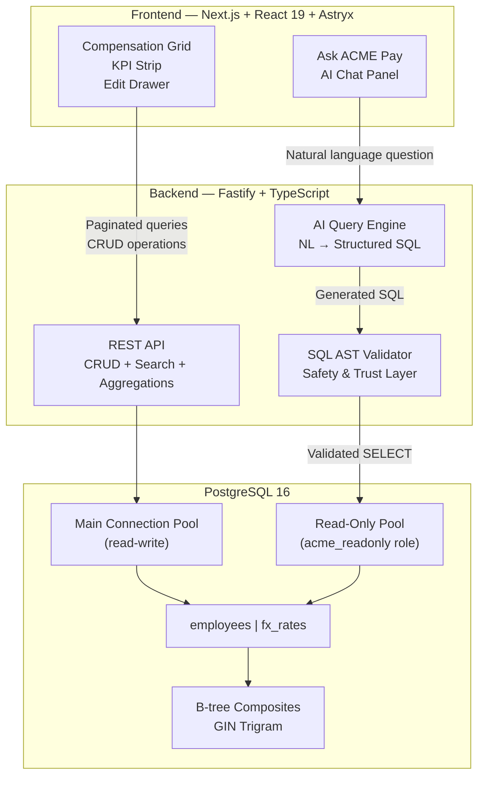
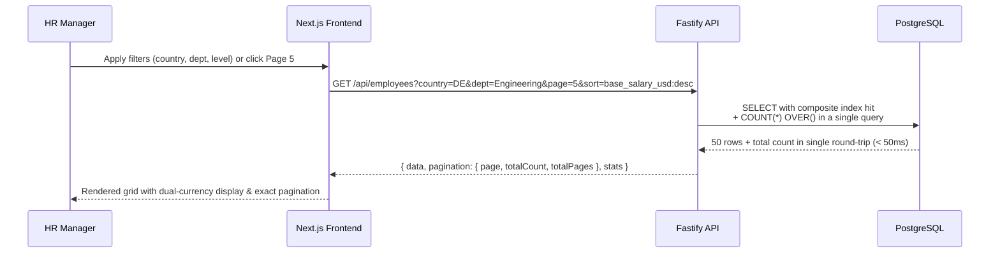
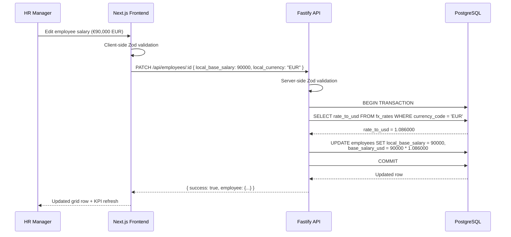
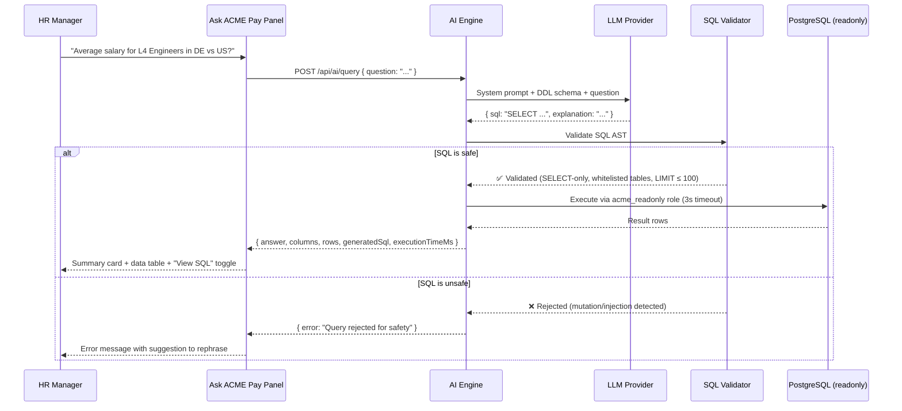
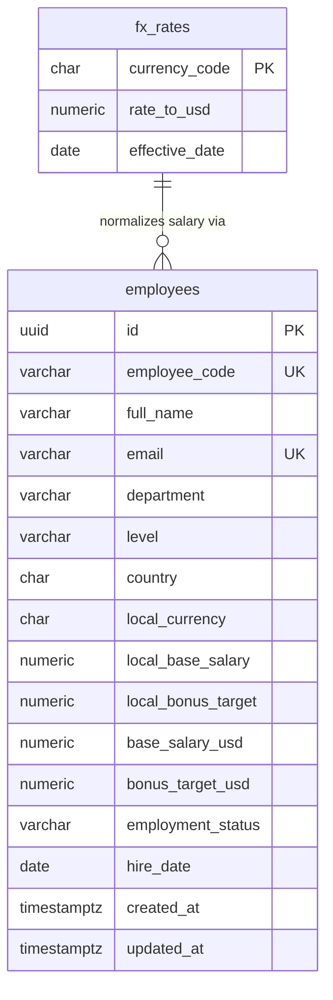
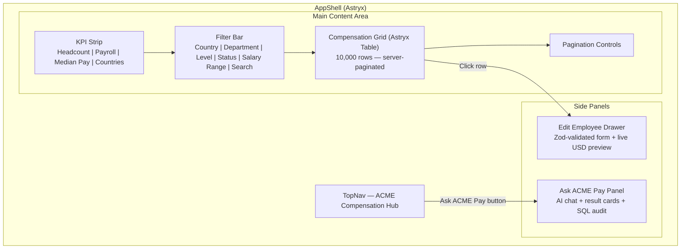
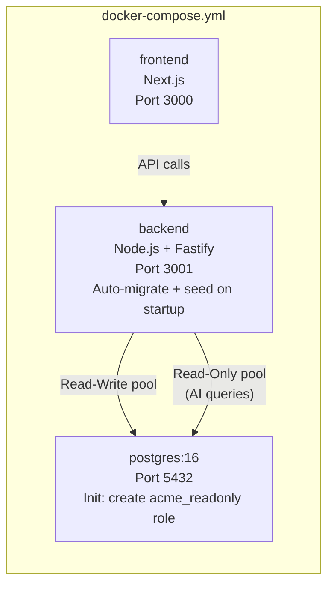

# Architecture Document: ACME Compensation Hub

> **Version:** 1.0  
> **Date:** 2026-11-13  
> **Status:** Design Phase

---

## 1. System Overview

ACME Compensation Hub is a full-stack web application providing centralized compensation management for 10,000+ global employees. The system consists of three main layers: a PostgreSQL database with performance-optimized indexes, a Fastify API server with Drizzle ORM, and a Next.js frontend with Meta Astryx UI components.



---

## 2. Data Flow Architecture

### 2.1 Employee Grid — Read Path



### 2.2 Employee Record — Write Path



### 2.3 AI Query — Ask ACME Pay



---

## 3. Database Schema Design

### 3.1 Entity-Relationship Diagram



### 3.2 Index Strategy

| Index Name | Type | Columns | Purpose |
|-----------|------|---------|---------|
| `idx_employees_dept_level_salary` | B-tree | `(department, level, base_salary_usd DESC)` | Filter by dept+level, sort by salary |
| `idx_employees_country_salary` | B-tree | `(country, base_salary_usd DESC)` | Filter by country, sort by salary |
| `idx_employees_status_hire_date` | B-tree | `(employment_status, hire_date DESC)` | Filter active employees, sort by tenure |
| `idx_employees_search_trgm` | GIN | `(full_name gin_trgm_ops, email gin_trgm_ops)` | Fast ILIKE fuzzy search on name/email |
| `idx_employees_code` | B-tree UNIQUE | `(employee_code)` | Unique constraint + fast lookup |
| `idx_employees_email` | B-tree UNIQUE | `(email)` | Unique constraint + fast lookup |

### 3.3 Currency Normalization Strategy

- **On Write**: When `local_base_salary` or `local_currency` changes, look up `fx_rates.rate_to_usd` and compute `base_salary_usd = local_base_salary * rate_to_usd` within the same transaction.
- **On Read**: All cross-country queries (sort, filter, aggregate, AI) use the precomputed `base_salary_usd`. Zero runtime FX joins needed.
- **FX Rate Updates**: When corporate FX rates change (quarterly), a batch job recalculates all `base_salary_usd` values. This is an admin operation, not part of the MVP UI.

---

## 4. API Design

### 4.1 Endpoints

| Method | Path | Description |
|--------|------|-------------|
| `GET` | `/api/employees` | Paginated, filterable, sortable employee list |
| `GET` | `/api/employees/stats` | Aggregate KPIs (headcount, payroll, median, countries) |
| `GET` | `/api/employees/:id` | Single employee detail |
| `POST` | `/api/employees` | Create new employee record |
| `PATCH` | `/api/employees/:id` | Update employee record (with USD recalculation) |
| `DELETE` | `/api/employees/:id` | Soft-delete (set status to terminated) |
| `GET` | `/api/fx-rates` | List current FX rates |
| `POST` | `/api/ai/query` | Natural-language compensation query |

### 4.2 Query Parameters — `GET /api/employees`

| Parameter | Type | Description |
|-----------|------|-------------|
| `page` | number | Page number (1-indexed) |
| `pageSize` | number | Rows per page (default 50, max 100) |
| `sort` | string | Column:direction (e.g., `base_salary_usd:desc`) |
| `country` | string[] | Filter by country codes |
| `department` | string[] | Filter by department names |
| `level` | string[] | Filter by job levels |
| `status` | string[] | Filter by employment status |
| `salaryMin` | number | Minimum base_salary_usd |
| `salaryMax` | number | Maximum base_salary_usd |
| `search` | string | Debounced fuzzy search (name, email, employee code) |

---

## 5. Frontend Architecture

### 5.1 Page Structure



### 5.2 State Management

- **Server State**: TanStack Query (React Query) for data fetching, caching, and cache invalidation on mutations.
- **URL State**: Filter and pagination state serialized in URL search params for shareability and browser history.
- **Local UI State**: React `useState` / `useReducer` for drawer open/close, form editing state.

---

## 6. AI Query Engine Architecture

### 6.1 Pipeline with Groq LPU Inference

```
User Question (HR Natural Language)
    ↓
[Prompt Engineering] — System prompt with DDL schema, FX rates context, few-shot examples
    ↓
[Groq Cloud API Call] — LPU high-speed inference (<500ms TTFT)
    - Default Model: llama-3.3-70b-versatile (JSON mode)
    - Fallback Model: llama-3.1-8b-instant
    - Structured output: { sql, explanation, visualizationType }
    ↓
[SQL AST Validator] — Parse → enforce SELECT-only, whitelist tables, inject LIMIT 100
    ↓
[Read-Only DB Execution] — acme_readonly role, 3s statement_timeout
    ↓
[Response Formatting] — { answerSummary, columns, rows, generatedSql, executionTimeMs }
```

### 6.2 Groq Free Tier & Rate Budgeting

- **Throughput:** Groq LPU delivers 250–750 tokens/sec, reducing response latency from typical 3–5 seconds to <800ms end-to-end.
- **Quota Management:**
  - `llama-3.3-70b-versatile`: 30 Requests/Min (RPM) and 1,000 Requests/Day (RPD).
  - `llama-3.1-8b-instant`: 30 Requests/Min (RPM) and 14,400 Requests/Day (RPD).
  - The application easily accommodates continuous evaluation sessions (20–30+ test queries) with zero cost.
- **Deterministic Offline Fallback:** If `GROQ_API_KEY` is not provided, the engine automatically routes to a pattern-based SQL generator so all core compensation inquiries work out of the box.

### 6.2 SQL Validator Rules

1. Must be a single SQL statement (no `;` separators after trimming).
2. Must start with `SELECT` or `WITH` (CTE allowed).
3. Reject keywords: `INSERT`, `UPDATE`, `DELETE`, `DROP`, `ALTER`, `TRUNCATE`, `GRANT`, `REVOKE`, `COPY`, `EXECUTE`, `pg_sleep`, `pg_terminate_backend`.
4. Whitelist table references: only `employees` and `fx_rates`.
5. Block system schemas: `pg_catalog`, `information_schema`, `pg_*` functions.
6. Enforce `LIMIT ≤ 100` — inject if missing, cap if larger.
7. No subqueries that modify data (enforce recursively).

---

## 7. Deployment Architecture



### Docker Services

| Service | Image | Port | Notes |
|---------|-------|------|-------|
| `postgres` | `postgres:16-alpine` | 5432 | Init script creates `acme_readonly` role with `GRANT SELECT ON employees, fx_rates` |
| `backend` | Multi-stage Node.js | 3001 | Runs migrations, seeds 10k rows if empty, starts Fastify |
| `frontend` | Multi-stage Next.js | 3000 | Connects to backend API |

---

## 8. Technology Decision Records

See [`docs/adr/`](file:///Users/narix/Code/interview/Incubyte/docs/adr/) for detailed Architecture Decision Records:

- [ADR-001](file:///Users/narix/Code/interview/Incubyte/docs/adr/ADR-001-tech-stack-and-monorepo.md): Tech Stack & Monorepo Structure
- [ADR-002](file:///Users/narix/Code/interview/Incubyte/docs/adr/ADR-002-dual-currency-and-db-indexing.md): Dual-Currency Data Model & Database Indexing
- [ADR-003](file:///Users/narix/Code/interview/Incubyte/docs/adr/ADR-003-safe-nl-to-sql-pipeline.md): Safe Natural-Language to SQL Pipeline
- [ADR-004](file:///Users/narix/Code/interview/Incubyte/docs/adr/ADR-004-astryx-ui-and-server-table.md): Astryx UI & Server-Driven Table
